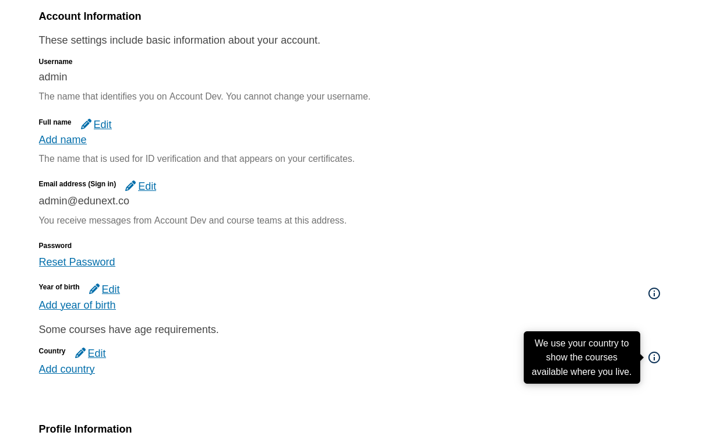
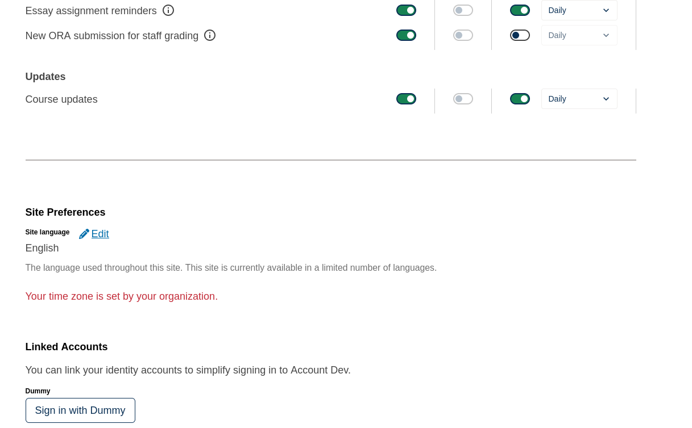

# Account settings sections

Each account settings section renders its fields through a Slot. Every field is a default
widget with its own ID, so a site can remove, replace, or insert content next to one field
with ordinary widget operations. Section headings, descriptions, and alerts stay outside the
Slots.

| Slot ID | Default widget IDs, in order |
|---|---|
| `org.openedx.frontend.slot.account.basicInformation.v1` | `usernameField`, `nameField`, `verifiedNameField`, `emailField`, `secondaryEmailField`, `resetPassword`, `yearOfBirthField`, `countryField`, `stateField` |
| `org.openedx.frontend.slot.account.profileInformation.v1` | `levelOfEducationField`, `genderField`, `workExperienceField`, `languageProficienciesField`, `additionalProfileFields` |
| `org.openedx.frontend.slot.account.socialMedia.v1` | `socialLinkLinkedinField`, `socialLinkFacebookField`, `socialLinkXField` |
| `org.openedx.frontend.slot.account.sitePreferences.v1` | `siteLanguageField`, `timeZoneField` |

Each widget ID is `org.openedx.frontend.widget.account.<name>.v1`. A widget whose field does not
apply to the current learner, such as `stateField` outside the United States, renders nothing but
stays in the list, so relative operations that target it keep working. The Slots have no props.

```tsx
import { WidgetOperationTypes } from '@openedx/frontend-base';

export default {
  slots: [
    {
      slotId: 'org.openedx.frontend.slot.account.socialMedia.v1',
      relatedId: 'org.openedx.frontend.widget.account.socialLinkXField.v1',
      op: WidgetOperationTypes.REMOVE,
    },
    {
      slotId: 'org.openedx.frontend.slot.account.sitePreferences.v1',
      id: 'org.openedx.frontend.widget.example.timeZoneNotice.v1',
      relatedId: 'org.openedx.frontend.widget.account.timeZoneField.v1',
      op: WidgetOperationTypes.REPLACE,
      component: TimeZoneNotice,
    },
    {
      slotId: 'org.openedx.frontend.slot.account.basicInformation.v1',
      id: 'org.openedx.frontend.widget.example.yearOfBirthHint.v1',
      relatedId: 'org.openedx.frontend.widget.account.yearOfBirthField.v1',
      op: WidgetOperationTypes.INSERT_AFTER,
      component: YearOfBirthHint,
    },
  ],
};
```

To decorate or highlight one field, replace the section's layout and wrap the widget you target,
using `useWidgets().identified` or `byId()`. A replaced field is display-only; it does not
receive the original field's editing or saving behavior.

## Examples

[`example/index.tsx`](./example/index.tsx) holds the components used below. The package exports
only the app, so copy the ones you need into your site.

The hint above, plus `FieldInfoLayout` on the basic information section, adds a hint under year of
birth and info tooltips beside year of birth and country:

```tsx
{
  slotId: 'org.openedx.frontend.slot.account.basicInformation.v1',
  op: LayoutOperationTypes.REPLACE,
  component: FieldInfoLayout,
},
{
  slotId: 'org.openedx.frontend.slot.account.basicInformation.v1',
  op: LayoutOperationTypes.OPTIONS,
  options: {
    info: {
      'org.openedx.frontend.widget.account.yearOfBirthField.v1': 'Some courses are only open to learners of a certain age, so we ask for your year of birth.',
      'org.openedx.frontend.widget.account.countryField.v1': 'We use your country to show the courses available where you live.',
    },
  },
},
```



The `REPLACE` operation above, with `TimeZoneNotice`, replaces the time zone field with a
display-only notice:



`SectionHighlightLayout` wraps the widget named by its `highlight` layout option in a bordered
container and scrolls it into view. A section has one layout, so combine it with
`FieldInfoLayout` in a single layout if a section needs both.
